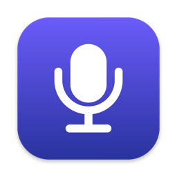
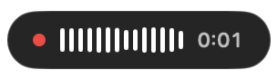
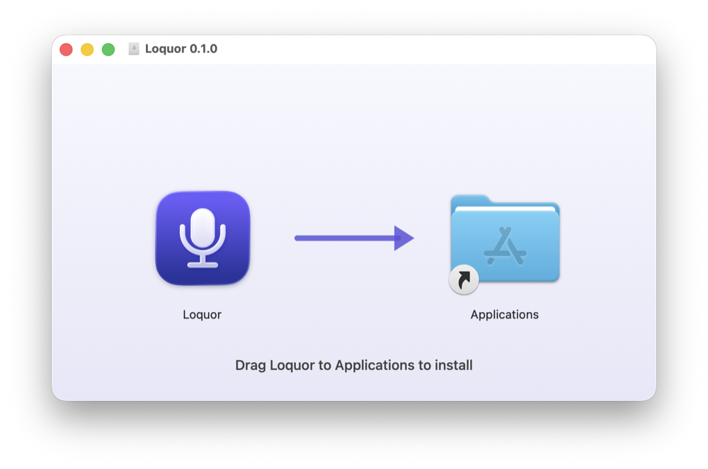
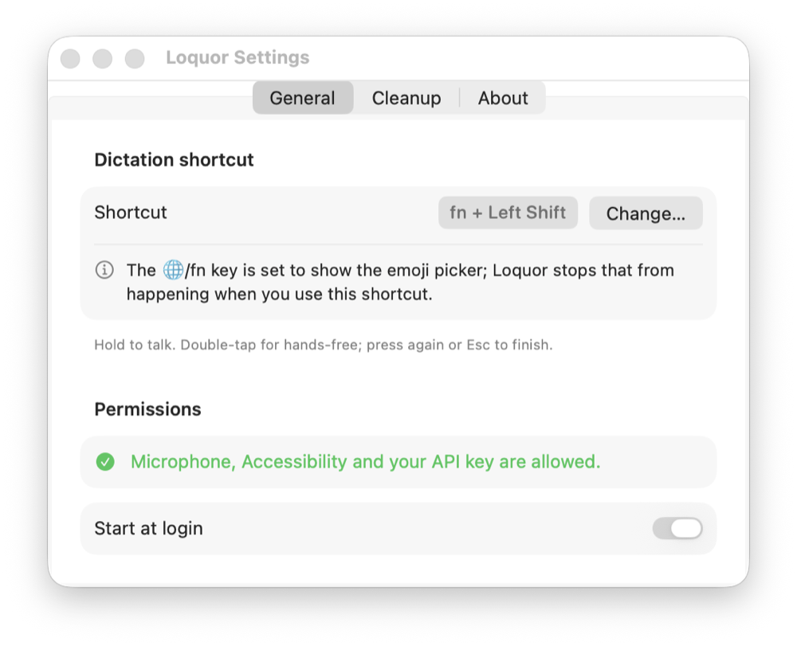
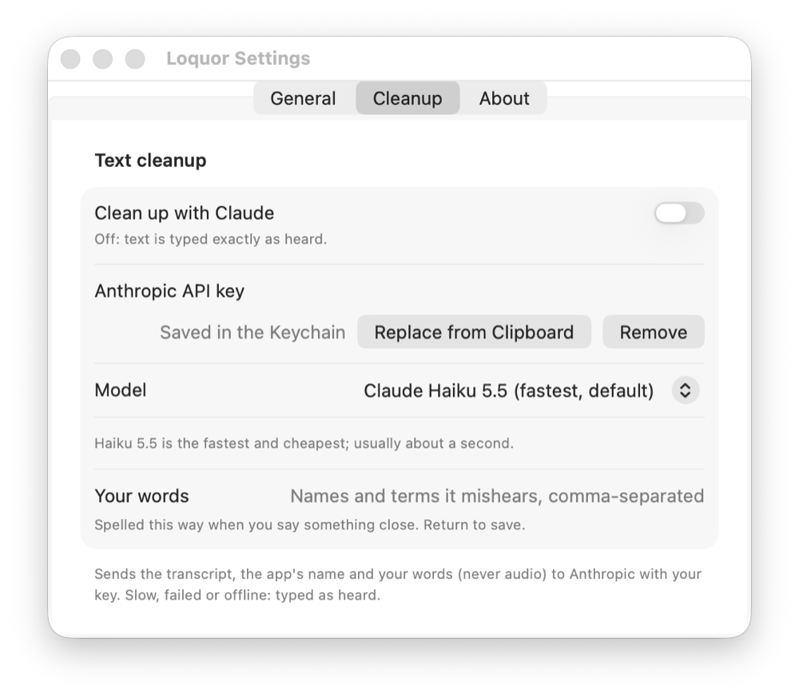
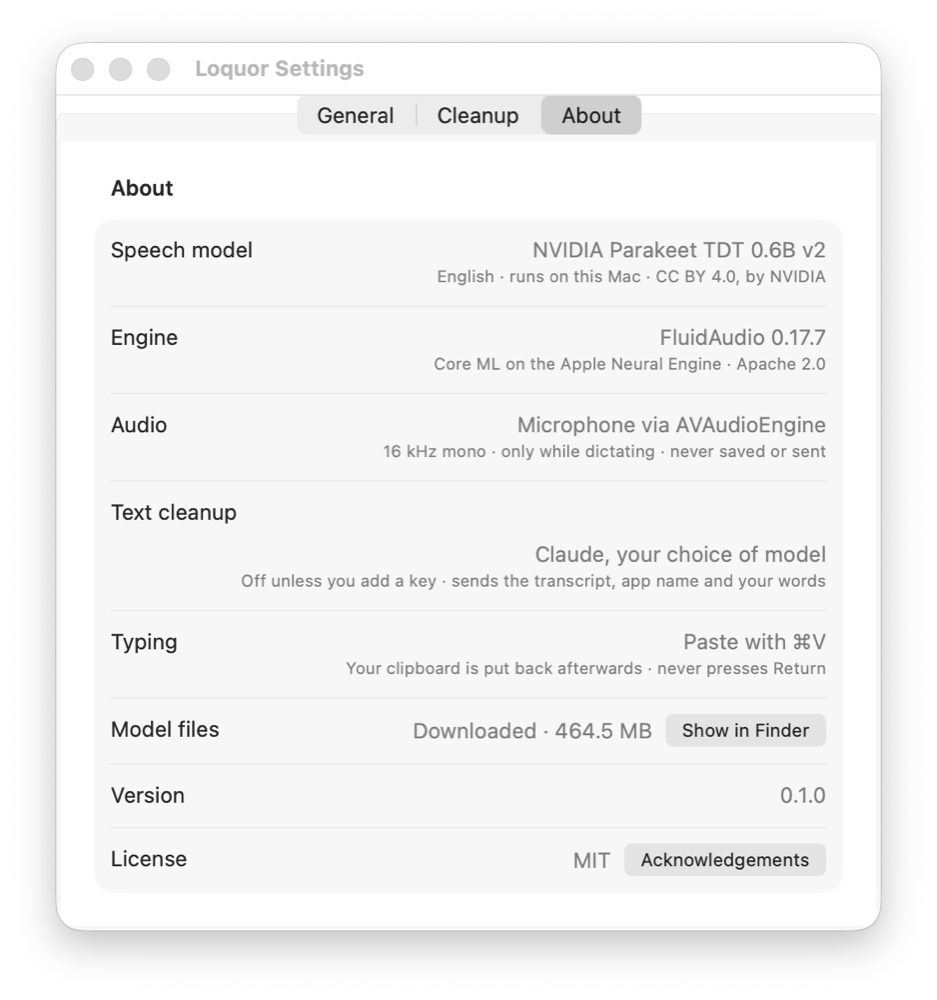

<p align="center">
  
</p>

<h1 align="center">Loquor</h1>

<p align="center">
  <b>Fast, private dictation for your Mac.</b><br>
  Hold a key, speak, let go: your words are typed into whatever app you're using.<br>
  Speech recognition runs entirely on your Mac. Nothing to subscribe to.
</p>

<p align="center">
  
</p>

---

*Loquor* is Latin for "I speak".

## Why

macOS's built-in dictation often mishears, and the good dictation apps charge a
monthly subscription for features most people don't need. Loquor does one thing
well: it turns your voice into text, on your Mac, in a fraction of a second.

## Features

- **Hold to talk.** Hold the shortcut, speak, let go. The text appears where your
  cursor is, in any app.
- **Hands-free.** Double-tap the shortcut and keep talking; press it again (or Esc)
  to finish.
- **Fast and accurate, on your Mac.** NVIDIA's Parakeet speech model runs on the
  Apple Neural Engine. On an M5 Pro, text lands about **100–150 ms** after you
  let go; older Macs take a little longer.
- **Private by default.** Audio never leaves your Mac and is never saved.
- **Choose your shortcut.** Default **fn + Left Shift**. Pick any other; Loquor
  warns you if macOS or your apps already use it and links to the setting to fix it.
- **A small on-screen indicator** while you speak, with a live waveform and a timer.
- **Up to 60 seconds per dictation:** plenty for a message or a paragraph. The
  timer counts down the last 10 seconds, and whatever you said is typed.
- **Optional cleanup with Claude.** Bring your own Anthropic API key and Loquor
  fixes punctuation, removes "um" and false starts, and applies "no wait, I mean…"
  corrections. Off by default. If it's slow, fails, or you're offline, your words
  are typed exactly as heard.
- **Nothing lost.** Never presses Enter for you, puts your clipboard back after
  pasting, and keeps the last dictation in the menu (**Copy Last Dictation**) in
  case the paste didn't land.

## Requirements

- A Mac with Apple Silicon (M1 or later)
- macOS 14 Sonoma or later (developed and tested on macOS 26)
- About 500 MB of disk space for the speech model
- English (the speech model is English-only)

## Install

1. Download **Loquor-x.y.z.dmg** from [Releases](../../releases).
2. Open it and drag **Loquor** to **Applications**.

   

3. Open Loquor from Applications. A microphone icon appears in the menu bar and
   Settings opens.
4. Allow **Microphone** and **Accessibility** (Settings has a button for each).
   Accessibility is how Loquor notices the shortcut and pastes your text.
5. The speech model (about 450 MB) downloads once; the menu shows the progress.

Then hold **fn + Left Shift** in any text field and speak.

> **Offline install:** **Loquor-x.y.z-offline.dmg** includes the speech model,
> so nothing is downloaded on first launch.

## Using it

| You do | Loquor does |
|---|---|
| Hold the shortcut, speak, let go | Types what you said |
| Double-tap the shortcut | Keeps listening hands-free |
| Press the shortcut again, or Esc | Finishes and types |
| Tap the shortcut once quickly | Nothing (a slip of the finger) |
| Press another key while holding it | Cancels (it was another shortcut, like fn + Shift + arrow) |

A recording stops at 60 seconds and types what you said; the indicator counts
down the last 10.

## Settings

Click the microphone in the menu bar and choose **Settings…**.

| General | Cleanup | About |
|---|---|---|
|  |  |  |
| Your shortcut (with conflict checks), permissions, start at login | Optional Claude cleanup: API key, model, your words | What Loquor is built from, and the licenses |

## Cleanup with Claude (optional)

Open **Settings › Cleanup**, copy your [Anthropic API key](https://console.anthropic.com/settings/keys)
and click **Paste from Clipboard**. Loquor checks the key with Anthropic before
saving it. Then:

- **Model:** pick any model your key can use. The default, **Claude Haiku 5.5**,
  is the fastest and cheapest, typically about a second.
- **Your words:** names and terms it should spell your way (people, products,
  company names).

When cleanup is on, Loquor sends Anthropic **the transcript, the name of the app
you're typing into** (so Slack stays casual and Mail stays formal) **and your word
list**. Audio is never sent.

### How your API key is kept

- Only in your **login Keychain**, never synced to iCloud. Never written to files,
  preferences or logs, and never shown again.
- Pasted from the clipboard, never typed; Loquor clears the clipboard afterwards.
- Sent only to `api.anthropic.com` over HTTPS.
- If macOS ever needs you to approve Loquor's access to the key (for example
  after an update of an unsigned build), Settings › General shows it as a step:
  click **Allow…** and choose **Always Allow**. Loquor never asks in the middle of
  a dictation; until then, your words are typed as heard.

## Privacy

| | |
|---|---|
| Audio | Recorded only while you use the shortcut. Transcribed on your Mac. Never saved, never sent. |
| Text | Stays on your Mac, unless you turn on cleanup (see above). |
| Settings | Shortcut, model and word list in `~/Library/Preferences/com.daghreri.loquor.plist` (not encrypted). |
| Logs | `~/Library/Logs/Loquor`: timings while the shortcut is in use, never what you said. |
| Network | Downloading the speech model once (unless you use the offline build), and cleanup if you turn it on. Nothing else. |

## What it's built from

| | |
|---|---|
| Speech model | [NVIDIA Parakeet TDT 0.6B v2](https://huggingface.co/nvidia/parakeet-tdt-0.6b-v2), CC BY 4.0, in the [Core ML conversion by FluidInference](https://huggingface.co/FluidInference/parakeet-tdt-0.6b-v2-coreml), pinned to one commit |
| Engine | [FluidAudio](https://github.com/FluidInference/FluidAudio), Apache 2.0, on the Apple Neural Engine |
| App | Swift and SwiftUI, Swift Package Manager |
| Cleanup | [Anthropic Messages API](https://docs.anthropic.com), optional |

## Build from source

Only the Xcode **Command Line Tools** are needed (`xcode-select --install`), not Xcode.

```bash
git clone https://github.com/daghreri/loquor.git && cd loquor
scripts/make-dev-cert.sh           # once: a local signing identity, so macOS
                                   # remembers permissions across rebuilds
scripts/build-app.sh --install     # build, copy to /Applications, launch
swift run selftest                 # logic checks
scripts/package.sh                 # release zip + dmg (model downloads on first launch)
scripts/package.sh --bundle-model  # offline release with the model inside
```

Signing and notarizing a release: [docs/releasing.md](docs/releasing.md).

| Folder | What's in it |
|---|---|
| `Sources/LoquorCore` | Pure logic: shortcut gestures, shortcut conflict checks, cleanup request and response |
| `Sources/Loquor` | The app: key monitor, recorder, transcriber, paster, indicator, settings |
| `Sources/selftest` | Checks for the core logic (`swift run selftest`) |
| `scripts/` | Build, package, local signing certificate, icon |
| `docs/` | Design notes and the release guide |

## Contributing

Issues and pull requests are welcome; see [CONTRIBUTING.md](CONTRIBUTING.md).

## License

[MIT](LICENSE). The speech model is licensed separately under
[CC BY 4.0](https://creativecommons.org/licenses/by/4.0/) by NVIDIA, and FluidAudio
under Apache 2.0; see [NOTICE](NOTICE).
